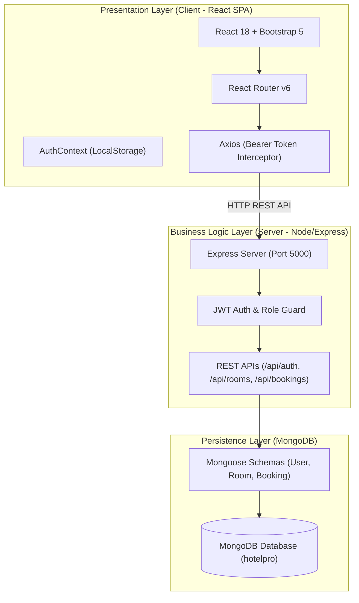
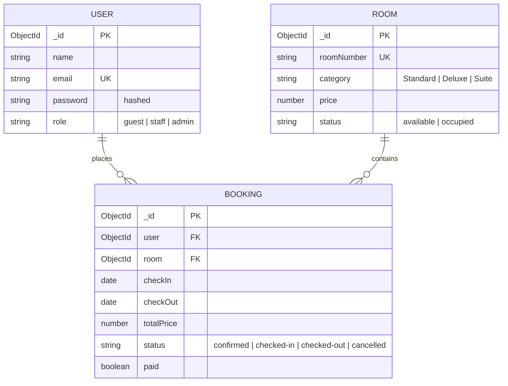
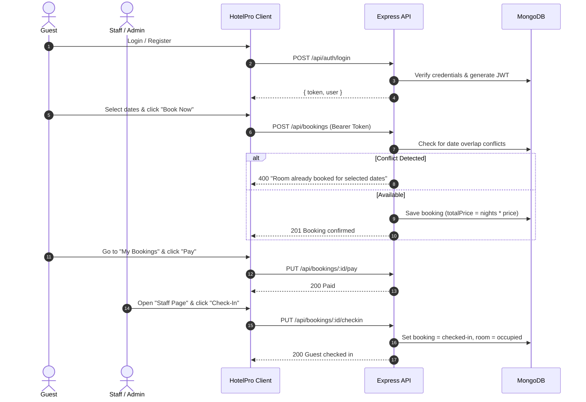

# HotelPro - Hotel Management & Booking System

A complete MERN-stack hotel management and room reservation system featuring role-based access control, real-time availability and date overlap validation, booking lifecycle tracking, and administrative inventory management.

📖 **Full Technical Documentation**: See [`docs/PROJECT_DOCUMENTATION.md`](docs/PROJECT_DOCUMENTATION.md) for in-depth architecture, API specifications, and code walkthroughs.

---

## 1. Technical & Project Architecture

HotelPro implements a 3-Tier Client-Server Architecture:



---

## 2. ER Diagram (Entity-Relationship)



---

## 3. Features

- **Authentication & Authorization**: Registration, login, password hashing with `bcryptjs`, and JWT Bearer token generation.
- **Room Browsing**: Filterable room cards by category (`Standard`, `Deluxe`, `Suite`) with live stay calculation.
- **Booking Engine**: Rejects reservations if dates overlap with an existing active booking for the same room; automatic price computation (`nights * price`).
- **Guest Self-Service**: Dedicated **My Bookings** page with mock payment processing and reservation cancellation.
- **Staff Operations**: Centralized dashboard to view all reservations with one-click **Check-In** (marks room occupied) and **Check-Out** (marks room available).
- **Admin Inventory Controls**: Admin form to add new rooms with category, pricing, and live inventory table.

---

## 4. Roles and Responsibilities

| Role | Responsibilities | Accessible Routes |
|---|---|---|
| **Public / Guest** | Browse catalog, select stay dates, book rooms, view **My Bookings**, execute mock payment, cancel reservations | `/rooms`, `/login`, `/my-bookings` |
| **Staff** | View hotel-wide reservations, manage guest arrivals (**Check-In**) and departures (**Check-Out**) | `/rooms`, `/staff` |
| **Admin** | Full staff privileges plus inventory management (add new rooms, manage room status) via **Admin Page** | `/rooms`, `/staff`, `/admin` |

---

## 5. User Flow



---

## 6. MVC Pattern in MERN

| Component | Responsibility in HotelPro | Project Location |
|---|---|---|
| **Model** | Enforces schemas, validations, data types, and references | `server/models/User.js`, `Room.js`, `Booking.js` |
| **View** | Interactive UI presentation, state handling, and user feedback | `client/src/pages/`, `client/src/components/` |
| **Controller** | Express routes & middleware handling business logic, role checks, and database queries | `server/routes/`, `server/middleware/auth.js` |

---

## 7. Tech Stack

- **Frontend**: React (Vite), React Router DOM (v6), Axios, Bootstrap 5
- **State & Auth**: React Context API (`AuthContext`), LocalStorage, JWT Bearer Token
- **Backend**: Node.js, Express.js
- **Database**: MongoDB with Mongoose ODM
- **Security & Utilities**: bcryptjs, dotenv, cors, nodemon

---

## 8. Setup & Project Execution

### Prerequisites
- Node.js (v18+)
- MongoDB running on `mongodb://127.0.0.1:27017`

### 1. Install Dependencies
```bash
# Server dependencies
cd server
npm install

# Client dependencies
cd ../client
npm install
```

### 2. Seed Database
Seeds 3 sample users (Admin, Staff, Guest) and 6 rooms:
- **Quick method**: Double-click [`seed.bat`](seed.bat)
- **Terminal**:
  ```bash
  cd server
  node seed.js
  ```

### 3. Start Backend Server
- **Quick method**: Double-click [`start-server.bat`](start-server.bat)
- **Terminal**:
  ```bash
  cd server
  npm run dev
  ```
*Server runs on `http://localhost:5000`*

### 4. Start Frontend Client
- **Quick method**: Double-click [`start-client.bat`](start-client.bat)
- **Terminal**:
  ```bash
  cd client
  npm run dev
  ```
*Client runs on `http://localhost:3000`*

---

## 9. Demo Logins

| Role | Email | Password |
|---|---|---|
| **Admin** | `admin@hotelpro.com` | `admin123` |
| **Staff** | `staff@hotelpro.com` | `staff123` |
| **Guest** | `guest@hotelpro.com` | `guest123` |

---

## 10. Output Screenshots & Demo Video

### Screenshots Guide
Screenshots can be added into [`docs/screenshots/`](docs/screenshots/):
- `01-login-register.png`: Authentication interface with role selection.
- `02-rooms-catalog.png`: Rooms catalog with category filter & stay date picker.
- `03-booking-confirmation.png`: Successful booking alert with price calculation.
- `04-my-bookings.png`: Guest reservations with Pay and Cancel buttons.
- `05-staff-dashboard.png`: Hotel-wide bookings with Check-In and Check-Out actions.
- `06-admin-panel.png`: Admin room creation form and live inventory table.

### Demo Video
- **Video Walkthrough Link**: `https://drive.google.com/file/d/1TUx0-HI9vgyB5SfcSBpaUpS3sdwxoVkD/view?usp=drive_link`

---

## 11. Future Scope

- **Real Payments**: Integrate Stripe, PayPal, or Razorpay for payment gateway transactions.
- **Email Notifications**: Automated booking confirmations and reminder emails via Nodemailer/SendGrid.
- **Image Uploads**: Room photo galleries with cloud storage (Cloudinary / AWS S3).
- **Reports & Analytics**: Visual revenue analytics, occupancy rates, and downloadable CSV/PDF reports.
