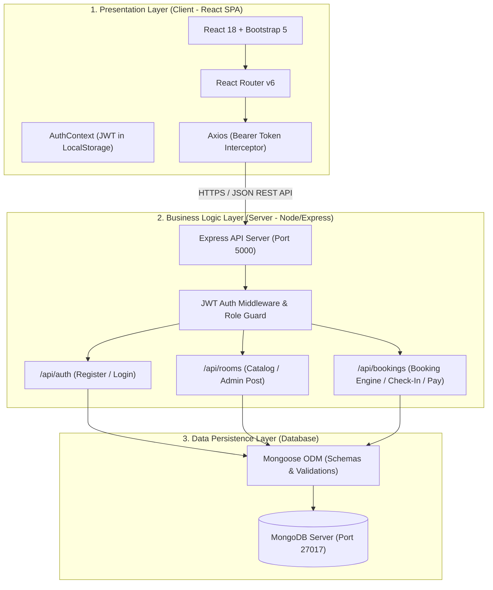
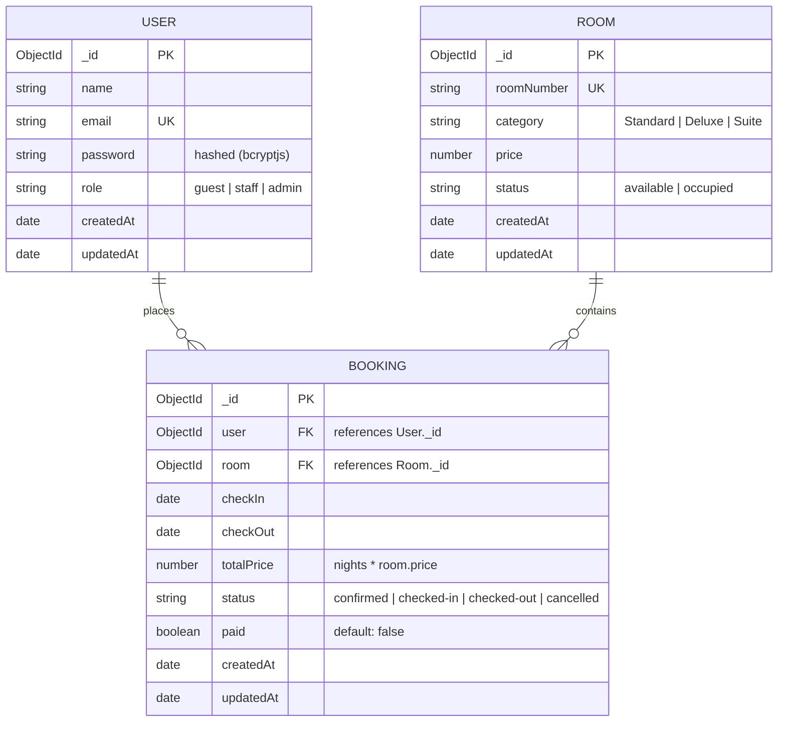
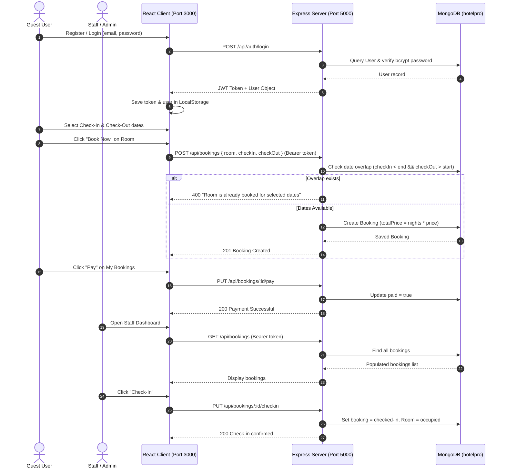

# HotelPro - Technical Project Documentation

Comprehensive technical documentation covering architecture, database models, user flows, MVC design pattern, backend/frontend implementation, and execution guidelines for HotelPro.

---

## 1. Technical Architecture & Project Architecture

HotelPro follows a modern **3-Tier Client-Server Architecture** separating the presentation layer, business logic layer, and persistence layer:



---

## 2. ER Diagram (Entity-Relationship)

HotelPro uses three core interconnected collections in MongoDB:



---

## 3. Features

### Authentication & Authorization
- Secure account registration with hashed passwords (`bcryptjs`).
- JWT-based authentication with 7-day signed tokens.
- Role-based authorization (`guest`, `staff`, `admin`) enforced on both frontend and backend.

### Room Management
- Public room browsing with dynamic category filtering (`Standard`, `Deluxe`, `Suite`).
- Real-time stay duration and total cost estimation based on selected dates.
- Admin room creation with unique room number constraints and real-time inventory monitoring.

### Booking & Reservation Engine
- **Conflict Prevention**: Rejects booking requests if selected check-in and check-out dates overlap with an active (non-cancelled) reservation for the target room.
- Dynamic price calculation (`totalPrice = nights * price`).
- Mock payment processing (`PUT /api/bookings/:id/pay`).
- Reservation cancellation with automatic room availability restoration.

### Hotel Staff & Admin Operations
- Hotel-wide booking log with guest details, payment statuses, and date ranges.
- One-click **Check-In** (sets booking to `checked-in` and room to `occupied`).
- One-click **Check-Out** (sets booking to `checked-out` and room back to `available`).

---

## 4. Roles and Responsibilities

| Role | Permissions & Responsibilities | Accessible Routes / Pages |
|---|---|---|
| **Public / Guest** | - Browse rooms & filter by category<br>- Select stay dates and view pricing<br>- Book rooms with date validation<br>- View personal bookings under **My Bookings**<br>- Pay for reservations & cancel bookings | `/rooms`<br>`/login`<br>`/my-bookings` |
| **Staff** | - Access **Staff Page**<br>- Monitor all guest reservations across the hotel<br>- Check in arriving guests (marks room occupied)<br>- Check out departing guests (marks room available) | `/rooms`<br>`/staff` |
| **Admin** | - All Staff privileges<br>- Access **Admin Page**<br>- Create new rooms with category, pricing, and status<br>- Manage full hotel inventory | `/rooms`<br>`/staff`<br>`/admin` |

---

## 5. User Flow



---

## 6. MVC Pattern Implementation

The project implements the **Model-View-Controller (MVC)** architectural pattern within the MERN stack:

```
               [ User Request ]
                      |
                      v
+-----------------------------------------------------------+
| VIEW (Presentation)                                       |
| React Components: RoomsPage, MyBookingsPage, StaffPage...  |
+-----------------------------------------------------------+
                      | Axios HTTP Call (REST API)
                      v
+-----------------------------------------------------------+
| CONTROLLER (Business Logic & Flow Control)                |
| Express Routes & Middleware: auth.js, bookings.js, rooms.js|
| Validates input, checks JWT roles, calculates pricing     |
+-----------------------------------------------------------+
                      | Mongoose Queries
                      v
+-----------------------------------------------------------+
| MODEL (Data Structure & Business Rules)                   |
| Mongoose Schemas: User.js, Room.js, Booking.js            |
| Enforces schema constraints, data types, and references   |
+-----------------------------------------------------------+
                      | Read/Write
                      v
               [ MongoDB Database ]
```

1. **Model (`/server/models`)**: Defines the data schema, validations, and default values (`User.js`, `Room.js`, `Booking.js`).
2. **View (`/client/src/pages`, `/client/src/components`)**: Renders interactive user interfaces using React and Bootstrap, accepting user input and displaying real-time feedback.
3. **Controller (`/server/routes`, `/server/middleware`)**: Handles incoming HTTP requests, verifies JWT tokens, checks user roles, validates business logic (e.g. date overlap conflict checks), and updates the Model.

---

## 7. Project Setup and Configuration

### Project Folder Structure
```
d:/Nasscom Project/
├── client/                     # Frontend Application
│   ├── src/
│   │   ├── api/axios.js        # Centralized Axios client with token interceptor
│   │   ├── components/         # Reusable Navbar and ProtectedRoute components
│   │   ├── context/            # AuthContext managing user & JWT state
│   │   ├── pages/              # AuthPage, RoomsPage, MyBookingsPage, StaffPage, AdminPage
│   │   ├── App.jsx             # React Router route registry
│   │   └── main.jsx            # React root mount
│   ├── index.html
│   ├── package.json
│   └── vite.config.js
│
├── server/                     # Backend Application
│   ├── config/
│   │   └── db.js               # MongoDB connection logic
│   ├── middleware/
│   │   └── auth.js             # JWT verification & role authorization guards
│   ├── models/                 # User, Room, and Booking Mongoose schemas
│   ├── routes/                 # auth.js, rooms.js, bookings.js
│   ├── .env                    # Environment secrets (PORT, MONGO_URI, JWT_SECRET)
│   ├── .env.example
│   ├── package.json
│   ├── seed.js                 # Database seeder (Admin, Staff, Guest, 6 Rooms)
│   └── server.js               # Express application entrypoint
│
├── docs/                       # Project Documentation & Screenshots
│   ├── screenshots/
│   └── PROJECT_DOCUMENTATION.md
├── .gitignore                  # Prevents node_modules, .env, and build artifacts from leaking
├── README.md
├── seed.bat                    # 1-click database seed launcher
├── start-client.bat            # 1-click frontend client launcher
└── start-server.bat            # 1-click backend server launcher
```

### Client Setup
- Built with **Vite** for fast HMR (Hot Module Replacement) and optimized production bundling.
- Configured in `vite.config.js` to run on `http://localhost:3000`.
- Dependencies: `react`, `react-dom`, `react-router-dom`, `axios`, `bootstrap`.

### Server Setup
- Built with **Node.js** and **Express.js** running on `http://localhost:5000`.
- Middleware stack: `cors` for cross-origin requests, `express.json()` for JSON payload parsing, and custom `auth.js` for JWT token handling.
- Dependencies: `express`, `mongoose`, `bcryptjs`, `jsonwebtoken`, `cors`, `dotenv`, `nodemon`.

---

## 8. Backend Development & Explanation

### 1. Database Connection (`server/config/db.js`)
Handles asynchronous connection to MongoDB via Mongoose with connection status logging and error termination handling.

### 2. Authentication & Authorization Middleware (`server/middleware/auth.js`)
- `verifyToken`: Extracts `Authorization: Bearer <token>` from headers, decodes the JWT with `JWT_SECRET`, retrieves the user record (excluding password), and attaches it to `req.user`.
- `authorizeRoles(...roles)`: Reusable role guard middleware checking if `req.user.role` matches allowed roles (returns `403 Forbidden` if unauthorized).

### 3. Date Overlap Conflict Detection Algorithm (`server/routes/bookings.js`)
To guarantee that a room is never double-booked, the backend queries the database for any non-cancelled reservation whose time range intersects with the requested stay:
```javascript
const overlap = await Booking.findOne({
  room: room._id,
  status: { $ne: 'cancelled' },
  checkIn: { $lt: end },
  checkOut: { $gt: start }
});
if (overlap) {
  return res.status(400).json({ message: 'Room is already booked for the selected dates' });
}
```

---

## 9. Database Development (MongoDB & Mongoose)

### MongoDB Configuration
- Default Local URI: `mongodb://127.0.0.1:27017/hotelpro`
- Configurable via `MONGO_URI` in `server/.env`.

### Schema & Models Breakdown

#### User Model (`server/models/User.js`)
- `name` (String, required): Guest/Staff full name.
- `email` (String, required, unique, lowercase, trimmed): Primary login identifier.
- `password` (String, required): Bcrypt-hashed password string.
- `role` (String, enum: `['guest', 'staff', 'admin']`, default: `'guest'`).

#### Room Model (`server/models/Room.js`)
- `roomNumber` (String, required, unique): Distinct room identifier (e.g. "101", "201").
- `category` (String, enum: `['Standard', 'Deluxe', 'Suite']`, required).
- `price` (Number, required): Nightly rate in USD.
- `status` (String, enum: `['available', 'occupied']`, default: `'available'`).

#### Booking Model (`server/models/Booking.js`)
- `user` (ObjectId ref `'User'`, required): Booking owner.
- `room` (ObjectId ref `'Room'`, required): Reserved room.
- `checkIn` (Date, required): Arrival date.
- `checkOut` (Date, required): Departure date.
- `totalPrice` (Number, required): Computed as `nights * room.price`.
- `status` (String, enum: `['confirmed', 'checked-in', 'checked-out', 'cancelled']`, default: `'confirmed'`).
- `paid` (Boolean, default: `false`): Tracks payment state.

---

## 10. Frontend Development & Explanation

### Centralized Axios Client (`client/src/api/axios.js`)
Configures a centralized Axios instance targeting `http://localhost:5000/api`. An interceptor automatically extracts `hotelpro_token` from `localStorage` and appends `Authorization: Bearer <token>` to all outbound requests.

### AuthContext (`client/src/context/AuthContext.jsx`)
Provides global authentication state (`user`, `token`, `login`, `register`, `logout`) synchronized with browser `localStorage`, preventing loss of login status upon page refresh.

### Role-Based Navbar (`client/src/components/Navbar.jsx`)
Conditionally renders navigation items depending on the active user's role:
- Guests see **Rooms** and **My Bookings**.
- Staff sees **Rooms** and **Staff Page**.
- Admins see **Rooms**, **Staff Page**, and **Admin Page**.
- Unauthenticated visitors see **Rooms** and **Login / Register**.

---

## 11. Steps for Project Execution

### Step 1: Ensure Prerequisites
- Node.js installed (`node -v`).
- MongoDB service running on `mongodb://127.0.0.1:27017`.

### Step 2: Seed the Database
Run the seeder to populate sample users and rooms:
- **Double-click**: `seed.bat`
- **Or command**:
  ```bash
  cd server
  node seed.js
  ```

### Step 3: Start the Backend Server
- **Double-click**: `start-server.bat`
- **Or command**:
  ```bash
  cd server
  npm run dev
  ```
  *Server starts on `http://localhost:5000`*

### Step 4: Start the Frontend Client
- **Double-click**: `start-client.bat`
- **Or command**:
  ```bash
  cd client
  npm run dev
  ```
  *Client starts on `http://localhost:3000`*

---

## 12. Output Screenshots

| # | Screen | Description | File Path |
|---|---|---|---|
| 1 | **Login / Register** | Tabbed authentication interface with role selection | `docs/screenshots/01-login-register.png` |
| 2 | **Room Catalog** | Filterable cards with stay date picker and cost estimate | `docs/screenshots/02-rooms-catalog.png` |
| 3 | **Booking Confirmation** | Success alert showing total price for selected nights | `docs/screenshots/03-booking-confirmation.png` |
| 4 | **My Bookings** | Guest view with mock Pay and Cancel buttons | `docs/screenshots/04-my-bookings.png` |
| 5 | **Staff Dashboard** | Staff/Admin overview with Check-In and Check-Out actions | `docs/screenshots/05-staff-dashboard.png` |
| 6 | **Admin Panel** | Add New Room form and live inventory table | `docs/screenshots/06-admin-panel.png` |

---

## 13. Demo Video

- **Video Walkthrough Placeholder**: `https://youtube.com/watch?v=YOUR_DEMO_VIDEO_ID`
- **Walkthrough Checklist for Video**:
  1. Demonstrate registration and login as **Guest** (`guest@hotelpro.com`).
  2. Filter rooms by category (`Standard`, `Deluxe`, `Suite`) and select dates.
  3. Book a room and show date overlap validation by attempting to book the same room on overlapping dates.
  4. Navigate to **My Bookings**, test **Pay**, and demonstrate reservation cancellation.
  5. Log in as **Staff** (`staff@hotelpro.com`) and demonstrate **Check-In** and **Check-Out**.
  6. Log in as **Admin** (`admin@hotelpro.com`) and demonstrate adding a new room to the inventory.
